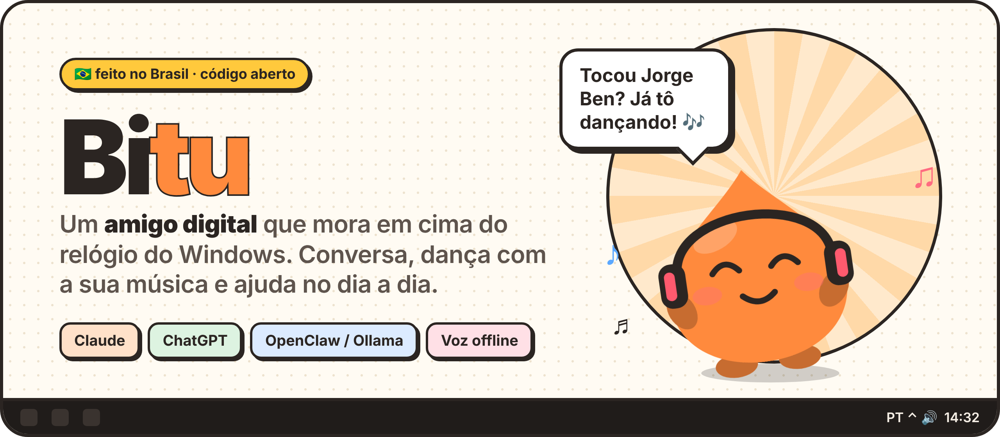
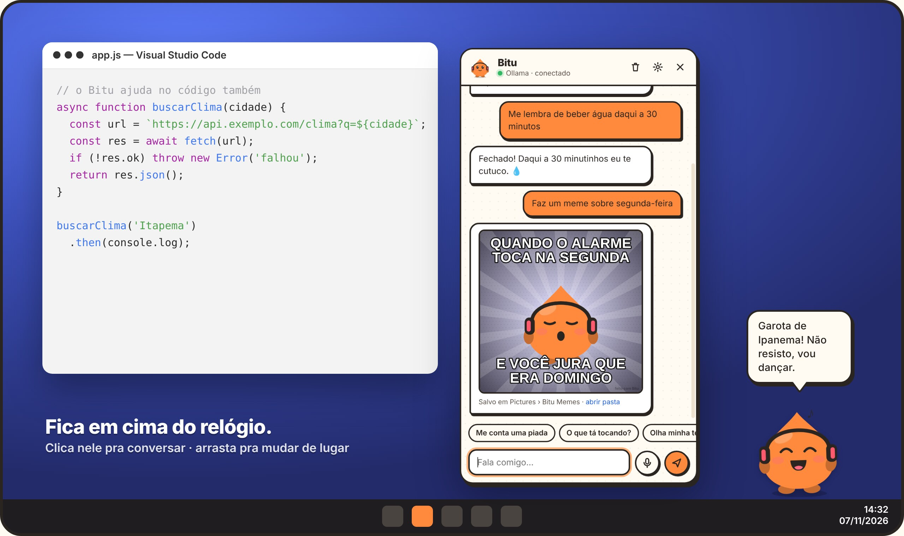
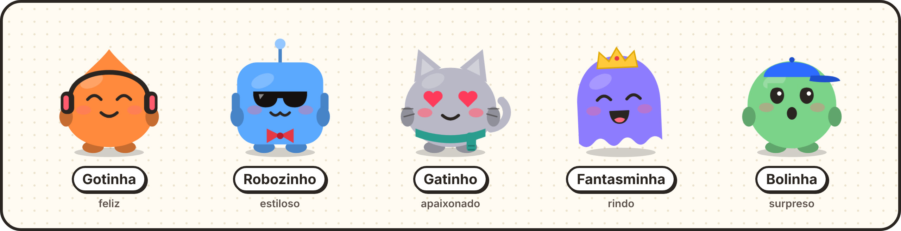
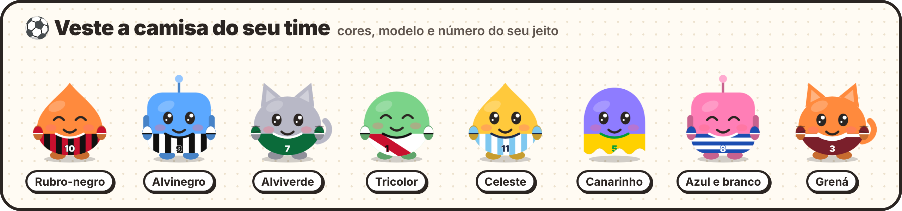
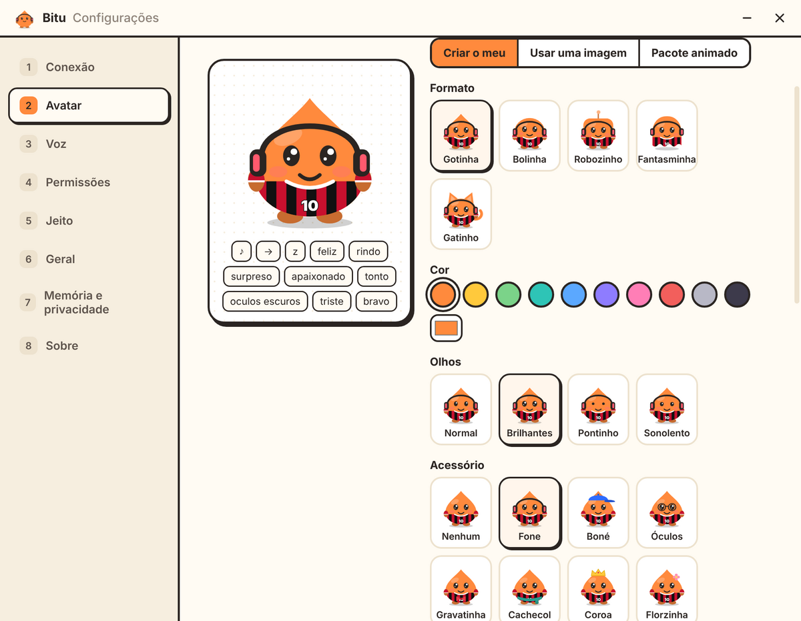
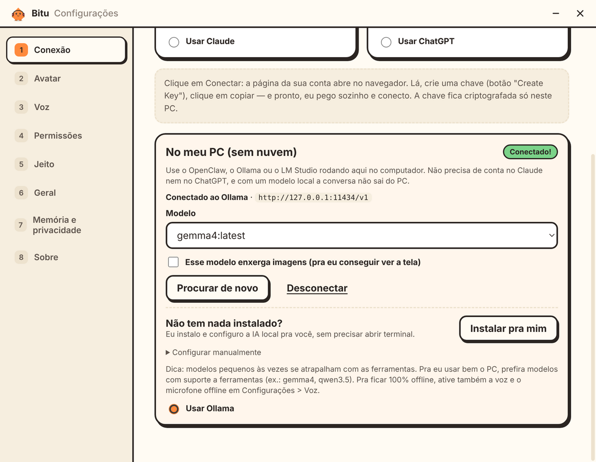
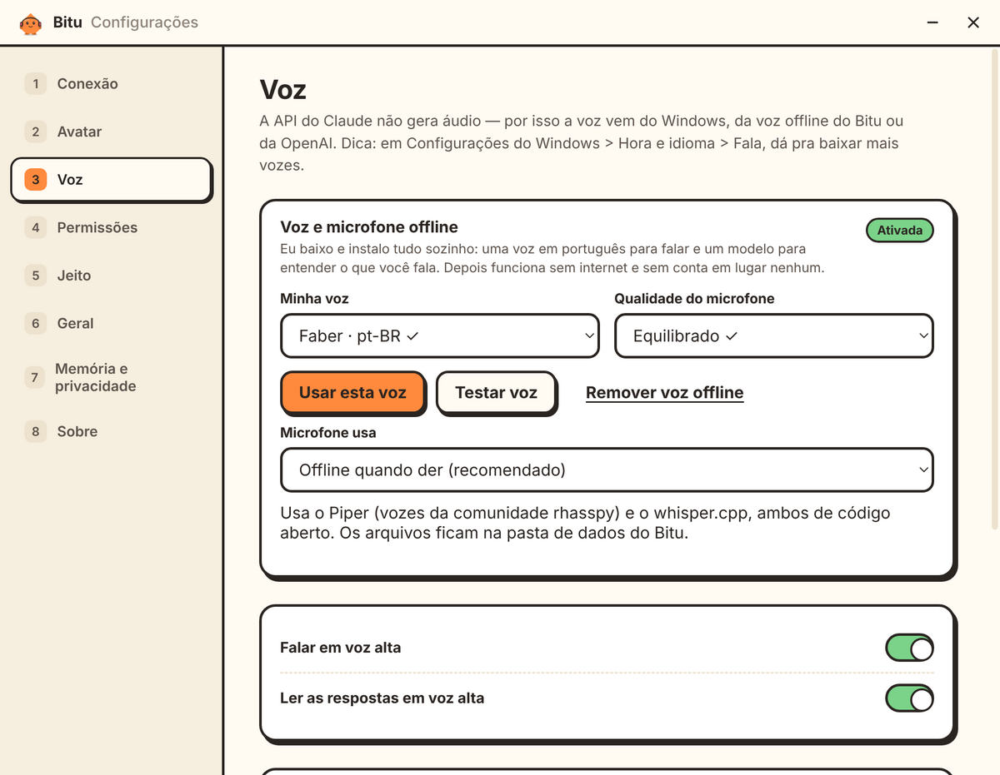

<p align="center">
  
</p>

<p align="center">
  <a href="https://github.com/sdalberto/bitu/releases/latest"></a>
  &nbsp;
  <a href="#-o-bitu-em-ação"></a>
  &nbsp;
  <a href="#-100-offline-sem-claude-e-sem-chatgpt"></a>
</p>

<p align="center">
  <a href="https://github.com/sdalberto/bitu/releases/latest"></a>
  <a href="https://github.com/sdalberto/bitu/releases"></a>
  
  <a href="LICENSE"></a>
  
</p>

<p align="center">
  <b>Conversa por voz · dança com a sua música · avisa as mensagens · ajuda no PC e no código</b><br>
  Funciona com <b>Claude</b>, <b>ChatGPT</b> ou <b>100% no seu PC</b> com OpenClaw / Ollama. Tudo fica salvo só no seu computador.<br>
  <sub><a href="#english">English</a> · <a href="#español">Español</a></sub>
</p>

---

## 👀 O Bitu em ação

<p align="center">
  
</p>

Ele fica em cima do relógio, sempre visível e sem atrapalhar. **Clique** para conversar, **arraste** para mudar de lugar e use o **botão direito** para abrir o menu.

## ✨ O que ele faz

<table>
<tr>
<td width="50%" valign="top">

**🗣️ Conversa de verdade**<br>
Por texto ou voz, com memória local do que você contou: gostos, nomes, projetos. Responde curtinho e em voz alta.

**🎵 Curte música com você**<br>
Percebe o que está tocando (Spotify, YouTube, Deezer…), comenta e dança junto.

**🔔 Avisa as mensagens**<br>
WhatsApp, Teams, Discord, Outlook…

**⏰ Lembretes**<br>
"Me lembra em 20 minutos de tirar o bolo do forno."

</td>
<td width="50%" valign="top">

**🛠️ Ajuda no PC e no código**<br>
Pesquisa na internet, abre sites e programas, controla a música, olha a sua tela quando você pede. Com a sua permissão, também clica, digita, roda comandos e lê e salva arquivos.

**⚽ Torce com você**<br>
Veste a camisa com as cores do seu time e comemora o gol.

**😂 Tem personalidade**<br>
Pisca, boceja, espirra, cochila quando você sai, fica tonto se você chacoalhar, faz memes com a própria cara e comemora o "sextou". Tem até um código secreto 🤫

**🌎 Fala português, inglês e espanhol**

</td>
</tr>
</table>

## 🎨 Monte o seu Bitu

<p align="center">
  
</p>

Escolha o formato, a cor, os olhos e o acessório. Se preferir, use qualquer imagem (PNG, GIF animado, WebP ou SVG) ou um **pacote animado** com várias poses. Veja como em [docs/AVATARES.md](docs/AVATARES.md).

### ⚽ Camisa do seu time

<p align="center">
  
</p>

Em **Configurações → Avatar → Camisa de time**, escolha uma combinação pronta (rubro-negro, alvinegro, alviverde, tricolor, celeste, canarinho…) ou monte a sua com o modelo (lisa, listrada, faixa diagonal, meio a meio, xadrez), as cores e o número. Quando você digita "gol", ele comemora junto. Escudos e marcas de clubes não entram, porque são registrados.

<p align="center">
  
</p>

## 🏠 100% offline, sem Claude e sem ChatGPT

O Bitu também pensa com uma IA que roda no seu computador. **Não precisa de conta nem de créditos.** E você não precisa abrir terminal: ele instala tudo sozinho.

<p align="center">
  
</p>

1. Abra **Configurações → Conexão → No meu PC** e clique em **Instalar pra mim**.
2. Escolha uma das opções:
   - **OpenClaw + Ollama (completo):** instala o Ollama, baixa o modelo, instala o [OpenClaw](https://openclaw.ai) pelo instalador oficial, configura tudo e conecta.
   - **Só Ollama (mais leve):** instala o [Ollama](https://ollama.com), baixa o modelo e conecta direto.
3. Acompanhe o progresso de cada etapa. No final, o Bitu já está conectado.

Se você já tem o OpenClaw, o Ollama ou o LM Studio instalado, clique em **Procurar no meu PC**. O Bitu encontra o programa, lê o token do OpenClaw sozinho e liga a conexão com outros apps com um clique.

### 🎙️ Voz e microfone offline

<p align="center">
  
</p>

Em **Configurações → Voz**, clique em **Ativar**. O Bitu baixa uma voz em português ([Piper](https://github.com/rhasspy/piper)) e um modelo que entende a sua fala ([whisper.cpp](https://github.com/ggml-org/whisper.cpp)). Depois disso, falar e ouvir funcionam sem internet.

> Dica: modelos locais pedem bastante memória. Com menos de 16 GB de RAM, a resposta pode demorar um pouco mais.

## ⬇️ Instalação

1. Baixe o **Bitu-Setup.exe** na página de [Releases](https://github.com/sdalberto/bitu/releases/latest).
2. Dê dois cliques. Ele instala sozinho e já abre.
   > O Windows pode mostrar a mensagem "O Windows protegeu o computador". Clique em **Mais informações → Executar assim mesmo**. Isso acontece com todo app novo que não tem certificado pago.
3. Siga o assistente de 1 minuto: idioma → nomes → conectar → avatar.

### Conectar no Claude ou no ChatGPT

Clique em **Conectar**. A página da sua conta abre no navegador: crie uma chave e clique em **Copiar**. O Bitu percebe a chave copiada, testa, conecta e limpa a área de transferência.

| | Onde criar a chave | Observação |
|---|---|---|
| **Claude** | [console.anthropic.com](https://console.anthropic.com/settings/keys) | Conta de desenvolvedor da Anthropic, com créditos pré-pagos. A assinatura do app Claude (Pro/Max) não serve para apps de terceiros. |
| **ChatGPT** | [platform.openai.com](https://platform.openai.com/api-keys) | Essa chave também libera o microfone e as vozes da OpenAI. |

A chave fica **criptografada pelo Windows** e só sai do seu PC para falar com a IA que você escolheu.

## 🔒 Segurança e privacidade

- **Tudo local:** as conversas, o caderninho de memória e os lembretes ficam no seu PC, criptografados com a proteção de dados do Windows.
- **Permissões desligadas por padrão:** ver a tela, mexer no mouse e no teclado, rodar comandos e mexer em arquivos. Você liga só o que quiser.
- **Ele pergunta antes de agir.** Comandos e salvar arquivos *sempre* perguntam, e salvar faz backup do arquivo anterior.
- **Botão de pânico:** `Ctrl+Alt+X` para tudo na hora.
- **Limites fixos:** ele nunca digita senhas e não faz compras nem transferências. O conteúdo de sites, arquivos e notificações é tratado como informação, nunca como ordem.

## ⌨️ Atalhos

| Atalho | O que faz |
|---|---|
| `Ctrl+Alt+B` | Abre/fecha a conversa |
| `Ctrl+Alt+Espaço` | Fala por voz |
| `Ctrl+Alt+X` | Para tudo |

No chat: `/piada` `/danca` `/dorme` `/cafe` `/estilo` `/festa` `/meme` `/casa` `/limpar` `/config` `/ajuda`

---

<details>
<summary><b>🧑‍💻 Para desenvolvedores</b></summary>

Requisitos: Windows 10/11 e [Node.js 22+](https://nodejs.org).

```bash
git clone https://github.com/sdalberto/bitu.git
cd bitu
npm install
npm start          # roda o app
npm run check      # confere sintaxe e traduções
npm run dist       # gera o instalador em dist/
```

Ou dê dois cliques em `instalar.bat`.

**Publicar uma versão nova:** altere `"version"` no `package.json`, faça o commit e crie a tag (`git tag v1.2.0 && git push --tags`). O GitHub Actions gera o instalador e publica em **Releases**.

```
src/
  main/
    main.js        janelas, bandeja, atalhos, permissões, conexão
    agent.js       personalidade + laço de ferramentas da IA
    providers.js   Claude, ChatGPT e servidores locais (formato OpenAI)
    local.js       OpenClaw / Ollama / LM Studio: detecção, token e config
    installer.js   instala Ollama, modelo e OpenClaw sozinho
    localvoice.js  voz (Piper) e microfone (whisper.cpp) offline
    download.js    downloads com progresso e descompactação
    tools.js       o que a IA pode fazer (com permissão e confirmação)
    winactions.js  mouse, teclado, mídia e janela ativa (user32 via PowerShell)
    watchers.js    música tocando e notificações do Windows
    store.js       armazenamento local criptografado
  preload/         ponte segura (lista fechada de canais)
  renderer/        personagem, conversa, configurações, avatar, voz e traduções
```

Sem dependências nativas para compilar. Variáveis úteis para testar fora do Windows: `BITU_VOICE_MIRROR` (servidor com os arquivos de voz) e `BITU_INSTALLER_DEMO=1` (simula o instalador).

**Limitações conhecidas**
- Para ler o conteúdo das notificações, o Windows precisa liberar o acesso em *Privacidade → Notificações*. Sem isso, o Bitu percebe as mensagens pelos contadores no título das janelas, e nem todo app mostra esse contador.
- O mouse e o teclado não funcionam em janelas de administrador, por proteção do próprio Windows.
- O controle do PC usa a tela principal.

</details>

## 📄 Licença

[MIT](LICENSE) © 2026 Silviano Dalberto Pessi — Ideias Livres Desenvolvimentos.<br>
Voz offline com [Piper](https://github.com/rhasspy/piper) e [whisper.cpp](https://github.com/ggml-org/whisper.cpp). IA local com [Ollama](https://ollama.com) e [OpenClaw](https://openclaw.ai). Todos têm licenças próprias.

---

## English

**Bitu** is a desktop buddy for Windows that lives above your taskbar clock. It chats by text or voice, notices the music you play and dances to it, tells you about new messages, searches the web and controls media. Only with your permission, it can also look at your screen, use the mouse and keyboard, run commands, and read and write code files. It works with **Claude**, **ChatGPT** or **fully offline**: it can install Ollama + OpenClaw for you, and offline voice and speech recognition with one click. Everything is stored locally and encrypted. **[Download for Windows](https://github.com/sdalberto/bitu/releases/latest)**

## Español

**Bitu** es un amigo digital para Windows que vive encima del reloj. Conversa por texto o voz, nota la música que suena y baila, avisa de mensajes nuevos, busca en internet y controla la música. Solo con tu permiso, también mira tu pantalla, usa el mouse y el teclado, ejecuta comandos y lee y guarda archivos de código. Funciona con **Claude**, **ChatGPT** o **100% sin conexión**: instala Ollama + OpenClaw por ti, y la voz y el micrófono sin conexión con un clic. Todo se guarda localmente y cifrado. **[Descargar para Windows](https://github.com/sdalberto/bitu/releases/latest)**
